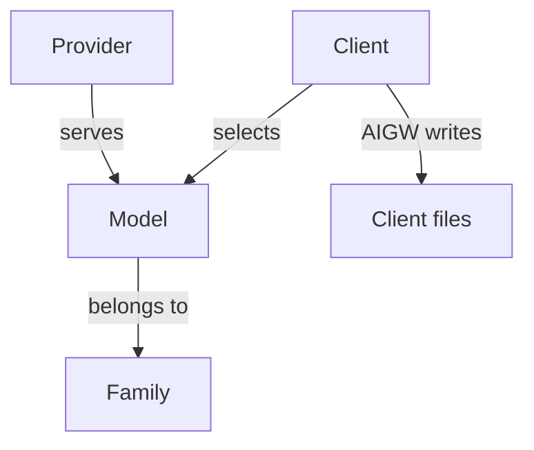

# Product Concepts

AIGW speaks of three nouns: provider, model and client. A client selects one
model, named `provider/model`. The provider holds the endpoints and the Token,
and AIGW writes only its own settings into the client's files. Tokens stay in a
separate credential backend.



## Glossary

Each concept has one canonical term. Code identifiers, package names,
specifications, documentation and human output use it. The spelling gate
refuses a rejected synonym outside history and reports the canonical term.

| Term         | Meaning                                                                                                     | Rejected synonyms         |
| ------------ | ----------------------------------------------------------------------------------------------------------- | ------------------------- |
| Provider     | A service you hold a Token for: an ID, a label, one endpoint per protocol and a Token                       |                           |
| Token        | The provider's API credential; it stays in the credential backend                                           |                           |
| Model        | What a provider serves, named `provider/model`; the part after the first `/` is the provider's own model ID |                           |
| Family       | Optional: which canonical model a provider's model is, so that variants and providers can be compared       |                           |
| Client       | An AI tool that AIGW supports: Claude Code, Codex, Claude Desktop or Hermes                                 |                           |
| Protocol     | An endpoint protocol: `anthropic`, `responses` or `chat`                                                    |                           |
| Client files | The AIGW-owned part of a client's native configuration                                                      |                           |
| Adapter      | The code that supports one client behind the `internal/adapter` seam                                        |                           |
| Catalog      | The model IDs that a provider lists for one protocol, as `aigw model search` reads them                     | `catalogue`, `catalogues` |

## Core entities

### Provider

A provider contains:

- an ID and a human label;
- an Anthropic, OpenAI Responses or OpenAI Chat Completions endpoint for each
  protocol that it serves;
- a Token slot in the selected backend when authentication requires it;
- an optional balance probe.

A team file can add a provider before its Token is available. A client that
uses client-native authentication delegates authentication to the client
instead of requiring that slot. Configuration and team files never contain the
Token. The reviewed distribution is [`manifests/team.toml`](../../manifests/team.toml);
it is the sole tracked team configuration and is directly consumable by
`aigw setup --from`.

### Model

A model is what one provider serves, named `provider/model`: the text before
the first `/` names the provider, and the rest is the provider's own model ID,
byte for byte, so `aihubmix/openai/gpt-oss` is model `openai/gpt-oss` of
provider `aihubmix`. AIGW never invents a model name. A model declares the
protocols on which AIGW may use it; AIGW never infers a protocol from a catalog
or a model's name.

Model IDs are the provider's own strings. AIGW does not infer a capability or
version policy from their spelling.

Authentication defaults to `provider-token`, which uses the provider's Token in
the selected backend. A client may instead select admitted client-native
authentication and its native provider identity. That client then owns
credentials and any signing, so AIGW does not require a Token. This
declaration is not evidence that the client or provider supports the selected
combination; check the actual invocation.

### Family

A family identifies one canonical model independently of provider, wire
protocol, provider channel, recommendation, and client state. A variant such as
`dmxapi/gpt-6.1-sol-cdx` belongs to family `gpt-6.1-sol`.

### Client selection

```bash
aigw use codex dmxapi/gpt-6.1-sol-cdx
aigw use claude dmxapi/claude-opus-5-5
```

Each client owns its selected model, enabled intent, client files, protocol,
authentication mode, and genuinely client-specific options. There is no global
default, inheritance, or cross-client fallback. AIGW selects before the
request; it does not retry traffic through another endpoint or model.

Team recommendations are not local selections. A team file stores them
separately. Setup may select recommendations for providers it connects or whose
Token already exists. Later `sync` may select an unselected client's reviewed
recommendation when its provider's Token appears in the read-only environment
backend; it does not search unused native credentials. An existing selection
survives a missing Token or a newly connected provider. See
[team activation](../guides/team-rollout.md#local-choices) for deliberate
selection changes.

### Client files

- **Codex:** recorded provider and model configuration, with a Token helper or
  explicit client-native authentication.
- **Claude Code:** official user-settings endpoint and model, and a credential
  helper.
- **Claude Desktop:** its separate third-party inference library.
- **Hermes:** its native provider catalog, explicit protocol and model
  selection, and credential commands.

An admitted client adapter writes and withdraws only AIGW's settings in its
client's files; it does not own provider behavior. Missing and unselected
clients remain untouched.

`aigw sync` adopts a model chosen in Hermes or Codex when it names exactly one
model of the selected provider and protocol and nothing else that AIGW owns in
that client changed; the result reports the adopted model, and an unknown or
ambiguous choice names `aigw use` commands instead. Explicit `use` replaces a
native choice only after proving that the owned providers and credential
commands are intact. Selection is not permission to overwrite a changed
provider definition.

## Endpoint

- Claude Code consumes the provider's Anthropic endpoint.
- Codex consumes the provider's OpenAI Responses endpoint.
- HTTPS is required except for an explicit loopback endpoint.
- A loopback process remains external to AIGW lifecycle ownership.

## Provider balance

Endpoint checks are provider-neutral. An exact balance or Token state is an
optional leaf capability, declared by a provider's balance probe and
implemented by a bundled diagnostic provider. `aigw provider balance` reports
it; `aigw provider edit --balance-token-stdin --balance-user-id <id>` stores
the precise balance credentials that some probes need.

An unknown probe kind does not invalidate the provider or a client's
selection. It makes only the optional balance unavailable.

## Provider catalog lifecycle

Provider catalogs are observations, not configuration. `aigw model search`
reads each selected provider's Anthropic Messages, OpenAI Chat Completions, and
OpenAI Responses catalogs, merges them into one row per model, and keeps in
`--json` which protocol listed each model. Membership proves neither inference
nor any capability.

| State        | Meaning                                                                                       |
| ------------ | --------------------------------------------------------------------------------------------- |
| `available`  | The provider lists the model, and it is not added                                             |
| `added`      | The model is in the configuration, and the provider lists it                                  |
| `missing`    | The model is in the configuration, and the provider no longer lists it                        |
| `deprecated` | A team file marks the model deprecated; it keeps an existing selection but is not recommended |

Qualification is separate evidence: explicit protocol and real-client evidence
for named capabilities. Removal is explicit, with `aigw model remove`, once no
client selects the model. Search compares the provider's own model ID, never
the family. A missing model is reported for requalification; it is not
renamed, deprecated, or removed automatically. Chat Completions success does
not qualify Responses, and Responses text success does not qualify reasoning,
tools, continuation, or compaction.

## Team files

`aigw setup --from` applies a token-free team file. For models, families and
recommendations, what the file names wins, and local-only entries stay unless
`--prune` removes the unused ones. A team file never changes an existing
provider's endpoints or Token and never replaces a client's selection: a
differing endpoint stays local and is reported. `aigw provider edit` changes an
endpoint deliberately.

## No rename

No command renames a provider or a model: a model's name follows from its
provider and the provider's own ID. To move a provider to a new ID, add it
under that ID with `aigw provider add`, point each client at its models with
`aigw use`, then remove the old provider with `aigw provider remove`.

## Installation lifecycle

Portable archives for macOS, Linux, and Windows use the CLI-owned lifecycle:
`aigw self install`, `aigw self update`, `aigw self rollback`, and
`aigw self uninstall`. Replacement retains one immediate predecessor and
restores the current program if activation fails. It is recoverable
replacement, not uninterrupted atomic visibility or power-loss recovery. The
macOS Homebrew Cask is a separate installation owner: Homebrew upgrades or
removes its program, and AIGW's portable update and uninstall commands refuse
to overwrite it. Linux and Windows currently use the published portable
archives, not an npm or native package-manager channel.

Before rollback, the retained program must start and read an isolated copy of
the current configuration. Incompatibility preserves the active program and
configuration; `aigw config rollback` restores a configuration that the
retained program may read. See the [rollback journey](../../README.md#update-and-rollback).

`aigw self status --json` observes the command path, running version, resolved
program file and optional retained predecessor through one schema-versioned
file-identity contract. This is computed from existing files: no installation
registry, source checkout or provider configuration is needed. Digests describe
observed bytes; they do not certify release trust, rollback readiness or client
connectivity. Install, update, rollback, uninstall and inspection share one
predecessor-path rule.
